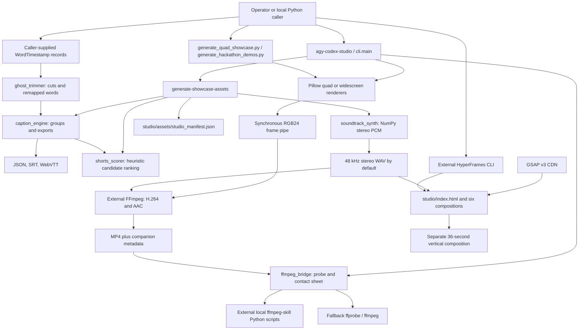
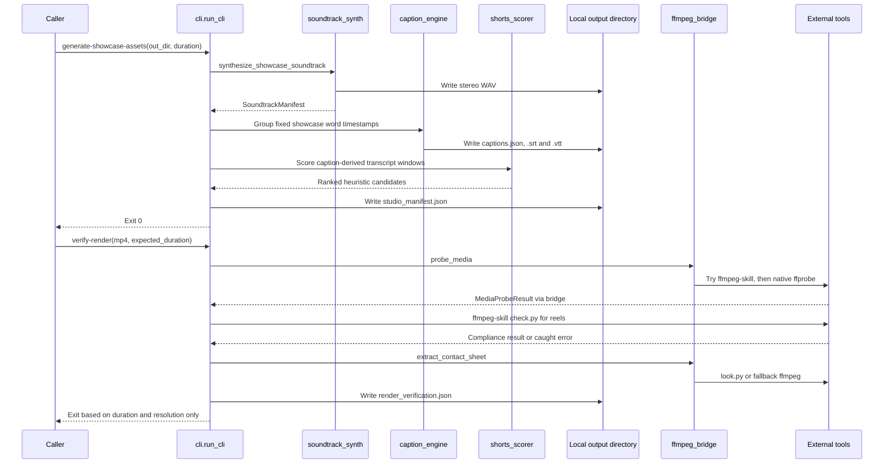

# AGY Codex Video Studio architecture

Source crosscheck: 2026-11-08 WIB. This document describes the checked-out implementation. Existing Graphify output supplied navigation, and source files confirmed every module boundary. No render, provider call or publication was performed during this documentation crosscheck.

## System context and data flow



The Python renderers produce a 24-second quad reel or two 24-second widescreen demos by default. HyperFrames is a separate rendering path around the 36-second HTML composition. The Python asset generator writes caption files, but `studio/compositions/captions.html` contains its own cue markup. It does not fetch the exported JSON automatically.

The repository draws engineering demonstrations and copies curated metric literals into manifests. Names such as `verified_metrics` and `verified_proof` do not trigger fresh hardware measurements, external benchmark execution or live inference. The trimmer returns cut decisions and remapped timestamps. It does not automatically cut a source media file. The Python entry points do not implement media downloading, speech recognition or a running multi-agent service. Doctor can inspect installations of those tools.

## Execution sequence



The final acceptance rule is the current implementation at `src/agy_codex_studio/cli.py:315-342`. FPS, codecs, audio presence and compliance results are reported but do not currently control that exit code. TECH_DEBT.md proposes a stricter contract.

## Modules and entry points

| File | Responsibility and state |
| --- | --- |
| `pyproject.toml` | Setuptools package from `src/`, Python >=3.11, console entry `agy_codex_studio.cli:main`. Runtime dependency list is currently empty despite NumPy and Pillow imports. |
| `src/agy_codex_studio/__init__.py` | Public exports. Eager CLI import pulls in the Pillow renderer even for package submodule imports. |
| `src/agy_codex_studio/contracts.py` | Mutable dataclasses for words, transcript segments, caption groups, cuts, candidates, probe and soundtrack results. Serialization checks finite numeric values and deep-copies nested metadata. |
| `src/agy_codex_studio/ghost_trimmer.py` | Normalizes word ordering, detects fillers and repeated 2-5 word prefixes within eight seconds, merges silence/retake cuts and remaps surviving word times. Work occurs in local lists and sets. |
| `src/agy_codex_studio/caption_engine.py` | Groups words by count, punctuation and pauses, sanitizes cue-breaking text, normalizes export bounds and writes UTF-8 JSON/SRT/VTT. JSON contains both grouped and millisecond caption schemas. |
| `src/agy_codex_studio/shorts_scorer.py` | Enumerates contiguous windows, combines five lexical/timing scores with weights 0.30/0.25/0.20/0.15/0.10, returns score-sorted candidates. These rules are not a trained virality model. |
| `src/agy_codex_studio/soundtrack_synth.py` | NumPy arrays for deterministic additive synthesis, beat pulses, envelopes, transitions and soft limiting. `wave` writes interleaved 16-bit stereo PCM. Peak/RMS dBFS are sample metrics, not a measured integrated LUFS or true-peak certification. |
| `src/agy_codex_studio/ffmpeg_bridge.py` | Injected subprocess adapters, script-name/path validation, noisy-JSON extraction, media probing and contact sheets. Local Windows ffmpeg-skill path is a default, not a bundled dependency. |
| `src/agy_codex_studio/cli.py` | Doctor, showcase assets, vertical render verification and quad showcase dispatch. Doctor all_ok becomes false for ffmpeg, ffprobe or ffmpeg-skill failure. Other tools have separate advisory status fields. |
| `src/agy_codex_studio/quad_showcase.py` | Four Pillow scenes, cached background/font objects, pure frame-index-based image construction and synchronous FFmpeg encoding. Default frame clock is 30 fps. |
| `src/agy_codex_studio/hackathon_demos.py` | Shared widescreen chrome plus BenchMind/RedFlag scene classes, subtitle/metadata generation and sequential two-demo encoding. |
| `generate_quad_showcase.py`, `generate_hackathon_demos.py` | Root launchers with src-path setup and target/output arguments. |
| `studio/index.html` | Five timed scene compositions, independent caption overlay and soundtrack. GSAP is loaded from a CDN. |
| `studio/compositions/scene1.html` through `scene5.html` | Paused GSAP timelines stored in window.__timelines for external seek-driven rendering. Scene 3 uses Canvas2D isometric projection at lines 106-192, despite older Three.js/WebGL wording in the spec. |

## State and concurrency

Each pipeline call owns its word/cut/caption lists, ranking candidates, output paths and dictionaries. Dataclasses remain mutable; serialization copies nested metadata but does not freeze the input objects. NumPy PCM arrays live for the whole soundtrack synthesis. Renderers retain fonts, caption groups and a background image, then copy the background for each frame.

Python orchestration and subprocess adapters are synchronous. A subprocess may run independently at OS level, but the caller waits or writes its frame pipe directly. No async scheduler, worker queue, database or persisted job registry exists. Frames stream to FFmpeg rather than accumulating a complete raw video in memory. The soundtrack remains an in-memory full-duration allocation. Outputs use explicit paths and may overwrite prior files.

The HTML path retains DOM, Canvas2D and GSAP timeline state per composition. Scene time drives the visual functions. The graph is a navigation aid and some indexed line numbers predate current source, so source locations above take precedence.

## Local verification

Run from the repository root with its Python dependencies installed in the selected environment:

```powershell
python -m pytest -q tests
```

Existing unit, integration, adversarial, property and mutation-harness tests cover the text/audio pipeline, serialization, render frames and injected tool boundaries. `tests/integration/test_pipeline_e2e.py` stubs FFmpeg processes and media probes while exercising real local caption/audio/file logic. This does not establish a freshly encoded playable MP4, live transcription, provider readiness or current coverage percentage. A packaging-only environment is a distinct check because required NumPy/Pillow are currently undeclared.

`tests/test_audit_compliance_boundary.py` adds two passing integration controls and four strict expected failures for independent compliance rejection. The focused 2026-11-08 run completed with 2 passed and 4 xfailed. It exercises the actual CLI verification and native-probe adapter with injected tool processes. The expected failures document the pending acceptance bug, not a production fix.
